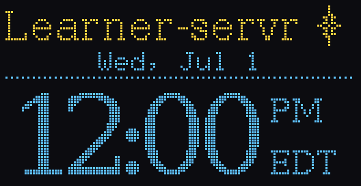

# Board review (branch `claude/esp32-32gb-memory-efficiency-n3dz1c`)

10 October 2026. A review of the ESP32 build as this branch leaves it: memory, the ways it fails that only a board has, what the screen and the updates add to the risks, and what is still unproven. The project-wide review is `../../REVIEW.md`; findings there are referred to by number ("review 24").

**Latest assessment:** see [Seventh round](#seventh-round-current-merge-memory-reliability-and-oled), below, against `0f5b884`. It qualifies the earlier verdict: host-profile measurements do not establish board headroom, and recovery, update admission and screen status still have concrete defects. The requested EST clock is implemented in this working tree; the other newly listed findings remain open.

Read in full: `../src/hub.cpp`, `http.hpp`, `fs.hpp`, `status.hpp`, `main/*.cpp`, `main/*.hpp`, the build files. Server behaviour was tested on a computer with the board's limits (`--profile esp32`): the comparison test (107 requests against the Node server then; since the merge with `marginalia-engine`, 260 against recorded answers), the same under AddressSanitizer and UBSan, a 20,000-file tree, a 3 GB file read past 2 GB, a damaged notes file, the status the screen reads. The board-only code (screen, Wi-Fi, card, updates) compiles with ESP-IDF 5.4.1 with and without mDNS, and the release signing was checked end to end (OpenSSL signs, the board's mbedTLS code verifies, tampering is refused). **None of it has run on a board.**

## Verdict

Listing memory is substantially improved: the list and titles are on the card, sorting has a budget, and traversal has a depth limit. The earlier host measurement on 20,000 files was 180 KB (194 KB with books after the merge), against 26 to 35 MB before. These are application-heap measurements on a computer, not the complete firmware's RAM demand. Notes, concurrent requests, TLS, task stacks and device bookkeeping still need separate budgets. Error messages and retries cover many board failures, but the seventh round below found gaps in power-cut recovery and update admission. Signed updates and rollback are useful defenses, not yet demonstrated on hardware.

What decides whether it works is now measurement on the board: free memory with several devices, stack headroom, the time to list a full card. The board logs the numbers needed (`/api/device`, and stack headroom after five minutes).

## Error boundaries

Ticked: handled on this branch. Each says what happened before and what happens now.

### Data

- [x] **An unreadable notes file was replaced by an empty one** (review 19, on the board). If `notes/notes.json` did not parse, the server took it as empty, and the next note saved wrote a list of one: every earlier note gone. On the board this was likely, not rare: a power cut during a save, or simply too little memory to parse a large file (cJSON then fails the same way). *Now:* a file that exists but cannot be read is never written over; saving answers 500 and the file stays for repair (since the merge: `notes.json is damaged and was left as it is; repair or remove it`, the wording `marginalia-engine` had for the same fix, made there separately). The same for `hub.json` (titles, highlight types, folder locks). The Node server, which had the old behaviour, is gone.
- [x] **A power cut between two steps of a save lost the file.** FAT cannot rename onto an existing file, so a save on the board is "delete the old one, rename the new one into place" (`secure::replace`). A cut between the two left only `notes.json.tmp`, and the server started with no notes. *Now:* at start-up the board puts such a file back (a `.tmp` with no file beside it is a finished save), deletes a `.tmp` that has its file (a save that never finished), and does the same in the state partition (devices, certificates) before reading it. Elsewhere a rename replaces in one step and nothing is touched.
- [x] **Interrupted uploads left partial files.** *Now:* on the board uploads are written in `.hub-cache/` and moved into place when complete; the cache folder is emptied at every start.
- [ ] **FAT itself has no journal.** A power cut while FAT's own tables are being written can damage the file system, whatever the server does. Nothing in software fixes that; a small UPS or a battery (the board has a charger) does. A computer's `fsck`/"First Aid" repairs most damage.
- [ ] **The certificate files are written one after another on first start.** A cut in the middle may leave a set that does not match; the next start then makes a new authority, and every device installs it again. Rare (first start only), and visible.

### The card

- [x] **No card, or not FAT32, at start-up**: the board returned from start-up and sat there, saying so only on the serial port. *Now:* the screen says so and it tries again every 5 seconds.
- [x] **No reader page on the card** (`hub/www/index.html`): the server refused to start, the board restarted every 30 seconds. *Now:* the screen says to run `make card`, and waits.
- [x] **The card taken out while running**: requests failed one by one, the count of what is stored belonged to a card no longer there. *Now:* FatFS checks the card before each use (ESP-IDF 5.1 and later), a watch notices within 3 seconds, and the board says so and restarts, waiting for a card. A clean start is the only safe way to take a new card: its contents, and the count, are another card's.
- [x] **Very deep folders**: each level of the list is stack, and connection threads have 12 KB. *Now:* the list and the count stop at 10 levels (64 on a computer) and say so once.
- [x] **Files of 2 to 4 GB**: their size read as negative, and reading past 2 GB failed (`off_t` is 32 bits). *Now:* read through FatFS (`fs.hpp`).
- [ ] **Large single folders are slow on FAT**: adding a name searches the folder from its start, and the short-name scheme searches again for similar names. Bounded in memory, not in time. README advises subfolders.

### Memory

- [x] **Out of memory while serving**: was already caught per connection (503, the connection closed). *Now also:* a connection is taken in only with 48 KB free, 20 KB of it in one block (one connection is always let in, so wrong thresholds cannot lock everyone out); event streams are refused (503) under the same condition; over the limit, connections wait in the listening queue instead of being dropped.
- [x] **The watcher kept every path twice** (review 24): no watcher on the board.
- [x] **The list as a JSON tree**: written out as it is made; on the card.
- [x] **`Content-Length` past 4 GB wrapped round** on a 32-bit board to a small number, so the rest of the body was read as the next request. *Now:* refused (413).
- [ ] **Fragmentation over weeks.** Free memory can stay large while the largest block shrinks; a TLS record needs 16 KB in one piece. The admission check refuses new connections rather than failing inside one, which keeps it safe, but it can make the board unhelpful after a long run. Measure `heapLargest` over days; a restart at a quiet hour once a week is the usual answer if it drifts.
- [ ] **The notes file is parsed whole** on every save (review 36): about ten times its size in memory. Bounded by how many notes there are, not by the card; one notes file per document is the fix (TODO).

### Network and start-up

- [x] **No Wi-Fi settings** (none built in): it tried an empty network forever. *Now:* "No Wi-Fi settings: put wifi.txt on the card".
- [x] **A network that cannot be joined**: the screen says so after 20 seconds and keeps trying.
- [x] **Wi-Fi lost while running**: it reconnected, silently. *Now:* "Wi-Fi lost: rejoining" until it has an address again. The reconnect waits a second inside the event handler, which also holds up other network events for that second; harmless here.
- [x] **The server could not start** (certificates, the folder): "the server stopped" on the serial port and nothing else. *Now:* on the screen, a restart after 30 seconds, and if this is a new firmware on trial, back to the previous one.
- [x] **No memory for the server's thread at start**: an uncaught exception, a crash, a restart loop. *Now:* caught, said, restarted.
- [x] **Pages that close** kept their place among the event streams until the next change; with 2 places, two closed tabs locked out the next device. *Now:* a closed stream is noticed when a new one asks (it has data to read: the close), 6 places.

### Stacks

Chosen by estimate, to be measured (the board logs the unused part of each after five minutes): connection threads 12 KB (TLS handshake, then the request, the list 10 levels deep at most), the server's start-up thread 16 KB (certificates: EC P-256, fast), the screen 6 KB, the update task 8 KB (a TLS handshake with certificate checks), the watch 6 KB.

## The T3-S3 V1.3 (third round)

The second board shares every line of the server and nearly all of the board code: the build target picks the pins (`main/board_pins.h`), `sdkconfig.defaults.esp32s3` adds PSRAM, and at start-up the server finds 2 MB of PSRAM and takes the `esp32-psram` profile. It builds (ESP-IDF 5.4.1; since the merge 1.37 MB with mDNS, 22% of the 1.75 MB update slot spare); it has not run.

- **What PSRAM changes.** mbedTLS allocates in PSRAM (`CONFIG_MBEDTLS_EXTERNAL_MEM_ALLOC`), so a connection's 20 KB of TLS buffers leave internal memory, and only its 12 KB stack stays. Hence 8 connections and 12 open pages, the page and its scripts kept in memory (about 380 KB) instead of read from the card on every load, and 512 KB to sort folder names in one pass.
- **What stays internal, on purpose.** Thread stacks: tasks with stacks in PSRAM cannot run while the flash cache is off (during flash writes, so during updates), and the SD card's SPI transfers would go through bounce buffers. Buffers of 16 KB and under (the 8 KB pieces files are sent in): DMA needs internal memory, and the SD driver would otherwise read a sector at a time.
- **The memory check** counts both: 40 KB of internal memory with a 16 KB block (a stack), and 96 KB of PSRAM.
- [ ] Measure on the board: `/api/device` gives `heapFree` (all memory), `psramFree`, `heapLargest`; the BOOT button shows internal and PSRAM free on the screen.
- [ ] Under the PlatformIO build, whether TLS buffers go to PSRAM depends on the Arduino core's settings; the memory check keeps it safe either way, but fewer may fit.

## Uploads of gigabytes (third round)

- [x] **The limit was the page's, as much as the board's.** The page dropped files over 50 MB without a word (review 21), whatever the server could take; the board took 4 MB. *Now:* both boards take up to 4 GB (FAT32's largest file); the page asks the server (`/api/device`, `maxUpload`) and lists what it leaves out, with the reason. "Add files", which keeps each file on the device until it is sent, stops at 200 MB, and says to use the folder button, which sends from the disk.
- [x] **A stalled upload held a connection for hours.** The time allowed was the whole body's (30 s plus its size at 32 KB/s: 36 hours for 4 GB). *Now:* each piece must also arrive within 30 seconds of the last.
- [ ] A long upload occupies one of the 4 (T3 V1.6.1) or 8 (T3-S3) places, and shares the SPI bus and the processor's TLS work with everyone else: the others slow down while it runs. Measured: not yet.

## Updates for two boards (third round)

- [x] Both boards fetching one release's image would have offered the T3-S3 the T3 V1.6.1's firmware (the image check would refuse it, and the S3 could then never update). *Now:* a release holds an image and a manifest per chip, and the chip is in the signed sentence, so one board's signed image cannot be passed to the other. Checked: each manifest is accepted by its own chip's code and refused by the other's.

## The screen

- It shows the pairing code to whoever is in the room. That is the point (physical presence is what pairing proves: review 23 asked for the address, the fingerprint and the code on the board), but it also means anyone near the board can pair while a code is on offer. Codes last ten minutes and are offered only when no device is paired or a paired device asks.
- It shows the names and addresses of connected devices to whoever is in the room. Fine at home; worth knowing elsewhere.
- It never makes the server walk the card: it reads the count already kept, and only once the server is up.
- It runs below the server in priority: under load the star stutters, the server does not.
- Device addresses are shortened only when all of them, and the board's, share their first two parts; then the board's own, whole on the line above, carries the part left out. One address from elsewhere (a VPN) and all are shown whole, so a shortened one is never ambiguous.
- [x] **It never dimmed** (found in the fourth round). "Nothing new for ten minutes" was judged by comparing each frame with the last below the title, but the address and the name take turns there every three seconds, more than four devices turn over in pages, and the tall star's diamond reached two rows below the title: something always changed. *Now:* `screen_sum` (`main/screen_draw.hpp`) gives a number for what the screen says (drawn as at frame 0, and every device, those on later pages too), and only a change in it counts; the star is cut at the title's band. Checked on a computer: ten idle minutes, no change counted (299 before); a device opening or closing a page, leaving from the second page, a notice, an alert, each counted.

## Updates

What an attacker needs, and what stops them:

| To get code onto the board | What stops it |
|---|---|
| Control of the GitHub repository or account | The signature: the board installs only images signed with your key, which is not on GitHub |
| A position on the network (rogue Wi-Fi, DNS) | HTTPS to GitHub, checked against the certificate bundle; and the signature regardless |
| An old, faulty release replayed | The version is inside the signature and must be higher than the running one |
| The signing key | Nothing: keep it off GitHub, off CI, backed up somewhere safe. If it leaks, reflash every board by USB with a new key |
| A broken release of your own | The new image is kept only after a minute of serving; before that, a crash or a failed start goes back to the previous one (ESP-IDF build; PlatformIO depends on the Arduino core's bootloader) |

- [ ] A release that boots and serves for a minute but is wrong in some other way stays. The fix is not to publish it; the board cannot know.
- [ ] Releases must be public (the board does not sign in to GitHub). Putting a GitHub token on the board would be a key to the repository on a removable-card device: a separate public repository for firmware is better.
- [x] Room: the merge with `marginalia-engine` brought the program to 1.37 MB with mDNS, more than the 1.38 MB slot could hold with room to grow. The slots are now 1.75 MB (the state partition 448 KB, still far more than certificates and devices need): about 384 KB spare on the T3 V1.6.1, 393 KB on the T3-S3. The new table is flashed by USB once, and pairing starts afresh; no board has the old one, whose firmware never built.

## The merge with marginalia-engine (fifth round)

`marginalia-engine` and this branch both started from the same commit of `main` and both reworked `hub.cpp` for weeks: 27 places where both changed the same lines. Merged by hand, keeping both: everything that branch built for documents and annotations, everything this branch built for memory and the boards. Checked after the merge: the contract test, 260 requests against the answers that branch recorded, identical on the desktop profile and under AddressSanitizer and UBSan, and on both board profiles but for two intended answers (no quota; `/api/files` in the card's order); the link test; that branch's browser suite (14 checks) and this branch's (back history, the list fetched 2 times for 10 uploads where it was 6, the upload limit); 20,632 documents listed (20,000 files, 20 books of 30 pages, 30 files of links) in 194 KB at the peak with the T3 V1.6.1's limits, against 180 KB before for the files alone; both firmwares built, with and without mDNS; the server compiled for Windows (MinGW, no warnings).

What the merge had to change in that branch's code for the board:
- [x] **A zip's end was looked for with a 64 KB block.** Every book opened (for the list, for a page, for a picture in it) allocated 64 KB in one piece to find the zip's directory: more than the T3 V1.6.1 can count on having in one block. *Now:* the last kilobyte first (where it is unless the zip has a comment), and the zip's list of entries no larger than the board's cap.
- [x] **A file worked on whole could be up to 1 MB** (`piece × 256`): a book's page, a file of links, a document mapped for anchors. *Now:* `most_held` per profile, 32 KB on the T3 V1.6.1 (the work takes two or three times the file), 1 MB on the T3-S3, where blocks over 16 KB go to PSRAM. Search reads each file only as far, not 2 MB.
- [x] **Folders were read with `readdir` and `stat` per name** in search and `/api/files`: on FAT that reads the folder from its start once for every name. *Now:* through FatFS like the list, and on the board in the card's order, so no folder's names are held to sort.
- [x] **The notes file was read whole a second time on every save**, to keep the version before: copied a piece at a time now. And each request parses it once, not once to check it and again to use it.
- [x] **`sys::move` called `lstat`**, which ESP-IDF does not have: the merged code would not have built for the board.
- [x] **Moving a folder into `.removed/` and letting it go** reset the count of what is stored, so the board would have walked the whole card again. *Now:* counted as it happens.
- [ ] **What the T3 V1.6.1 unpacks itself is 32 KB at most.** The reader's engine reads books by range requests, so pages of any size are read and highlighted. But to list a book the board unpacks its contents (the package file and the table of contents), and a book whose contents unpack to more than 32 KB (hundreds of chapters), or whose zip lists thousands of files, is left out of the list there; a page over 32 KB is also not shown when the engine is not there. Unpacking a piece at a time would lift both; the T3-S3 holds 1 MB.
- [ ] **Not tried on a board, nor run on Windows** (only compiled there).
- [x] **The T3-S3 would have tried to keep the engine's 2.6 MB WebAssembly in memory** (found after the merge, sixth round). Its profile keeps page files in memory, which was sized for the page and its scripts; since the merge they include the document engine and PDF.js. *Now:* a page file is kept only within `most_held` (1 MB in all on the T3-S3), the rest sent from the card; and kept files are shared by the answers that send them, never copied for each.

## Other things checked

- Sorting with bounded memory gives the same order as sorting everything: compared on 20,000 files, and on a 3,000-entry folder holding 2,000-entry folders (where a folder holding most of the budget lets its names go while an inner one is walked, so the inner one is not starved).
- The title cache reuses a title only if the file's size and time are unchanged; an edited heading showed up in the next list.
- The status the screen reads was exercised under the sanitizers: pairing, the countdown, the notice, a page opening and closing.
- `hub.local` and the board's name are in the host names the server accepts and in the certificate.

## Would reactive programming help?

Asked alongside this review. For the server on the board, the reactive *libraries* (observables, RxCpp) would add code and memory to a program short of both. The idea underneath, reacting to events as they arrive instead of polling or blocking, is what helps, and this branch already moves that way: changes are announced as they happen instead of the folder being polled, and the screen redraws from a status that the server keeps up to date. The next step in that direction is an event loop (one thread reacting to whichever connection is ready) instead of a thread per connection: that is what would let many more devices in (TODO). For the page (`hub/app.js`), a small reactive state model (signals) would address review 39, lists rebuilt in full for small changes.

## Seventh round: current merge, memory, reliability and OLED

10 October 2026, assessed at `0f5b884`, followed by the requested clock implementation. Scope: `esp32/main`, build settings, release tooling, and shared server paths the boards execute. This is a continuation of the review, not a claim that all firmware has been tested. No board was flashed, no live workspace was used, and the three pre-existing `.vscode` changes were left alone.

### Merge handoff

The merge is already complete and pushed: `789bfed` has parents `9c888bf` (board work) and `6bdac21` (annotation branch). The annotation branch contains seven commits after `marginalia-engine` at `9de2e87`: `ec9a4f1`, `33893b1`, `0ac95a7`, `4c71490`, `1555895`, `c1ac1d9`, `6bdac21`. Board development before the merge is `9952be2`, `b4ee170`, `4a5c5f1`, `9c888bf`; after it, `681b7a5` makes the memory improvements apply on all platforms and `0f5b884` adds the Linux heap regression test. Remote tips were verified with `git ls-remote`, without fetching or modifying branches.

There is no `MERGE_HEAD` and no unmerged index entry. At inspection, `marginalia-engine` has 0 unique commits and the ESP32 tip has 14; `main` at `d8d878f` has 0 unique commits and the tip has 32. After validation and committing the intended working-tree changes, both remaining steps can therefore use `git merge --ff-only`: ESP32 into `marginalia-engine`, then that branch into `main`. Recheck the remote tips first if another session continues work. No reset, history replacement or force-push is necessary to make `main` contain this work. No branch was moved in this review.

### Evidence from this pass

- Windows isolated server build succeeded through `node start.mjs --win test-own`. The 260-request contract comparison differed only on three font requests: expected 200, actual 404. Both `@fontsource` packages are absent from this checkout's `hub/node_modules`. This is an incomplete local dependency installation, not evidence that the complete suite passes. Expected answers were not changed. The separate links test reports a Windows skip because its symbolic-link setup needs extra rights.
- A scratch HTTPS server using the actual `esp32` profile held an idle keep-alive connection for **15.0 seconds**, although that profile specifies 2 seconds (B03).
- A Windows harness including the actual `hub.cpp` called `hub_status` from the initialized request context and from a fresh thread: free space was nonzero in the former and **zero in the latter**. With eight paired devices having longer names/IDs, one status call made **25 C++ allocations** (B04). This tests the common code; it does not emulate ESP-IDF's allocator.
- Built and visually inspected the OLED renderer on Windows. Clock tests pass for midnight/noon, date/year rollover, fixed UTC-5 in summer, button debounce/cycling, eight-second details timeout, ten-minute idle transition, activity wakeup, and all urgent-screen overrides. The reproducible test is `tools/screen-test.cpp`; `tools/screen-preview.cpp` also renders the clock and unsynchronized state.
- No new on-board memory measurement or full firmware build. The locally installed Arduino framework is **2.0.17**; this project requires 3.x/ESP-IDF 5.x. The existing Linux/glibc-only `test/memory.sh` was inspected, not rerun on Windows. Board Wi-Fi/TLS costs, allocator fragmentation, FatFS and task stack headroom remain unmeasured here.

Scratch evidence is under `../build/esp32-review-20261010/` (ignored): `tls_idle.py`, `status_probe.cpp`, their binaries/logs, and OLED PNGs. These are investigation artifacts; the clock regression test is tracked.

### Open findings, in priority order

- [ ] **B01 — High: temporary-file recovery does not prove a save completed.** `../src/hub.cpp:1423` promotes `name.tmp` whenever `name` is absent. A power cut during the *first* write to a new file also leaves exactly that arrangement, with incomplete contents. In addition, `../src/platform.hpp:198` unlinks the old FAT target before renaming; if rename fails, `write_file`/`copy_file` then unlink the complete temporary too (`hub.cpp:201`, `239`). This weakens the earlier “no lost notes” claim. *Static control-flow finding; power-cut/fault injection still needed.* Use an explicit completed-write/backup protocol, retain recoverable bytes after replacement failure, and test first creation, overwrite, and rename failure separately. Preserve malformed candidates for diagnosis instead of treating absence of the target as a commit marker.

- [ ] **B02 — High when OTA is enabled: the update safety gate expires, and no serving reservation lasts through installation.** `main/update.cpp:204` waits up to 60 one-minute intervals while busy or below its memory thresholds, then calls `check_once()` unconditionally. Even if it starts idle, new requests remain admitted during download and the eventual automatic reboot. `hub_busy()` counts connection threads, not retained event-stream TLS sessions. Consequently a long upload can overlap OTA and be interrupted by restart, and low-memory conditions can still trigger an outgoing TLS handshake. *Confirmed by reading; no live OTA attempted.* Skip/defer the check when thresholds still fail, reserve the resources OTA needs, and coordinate request admission/draining before reboot. The checked-in public key is empty, so automatic installation is currently disabled in the default build.

- [ ] **B03 — Medium: HTTPS bypasses the board's short idle timeout.** `../src/http.hpp:493` sets the profile's keep-alive deadline and immediately replaces it with 15 seconds whenever `conn->tls` is true. Reproduced: 15.0 seconds on the `esp32` profile, configured for 2 seconds; the same condition also bypasses the S3's 5-second setting. Idle browser connections retain a thread stack, socket and TLS context longer than intended. Wait for the next TLS application data using the idle deadline, then apply the header deadline; test TLS as well as plain HTTP.

- [ ] **B04 — Medium: OLED status is neither allocation-free nor independent of the calling thread.** `../src/status.hpp` promises no allocation, but `hub_status` (`hub.cpp:3109`) constructs a map of all devices, a set of live devices, a vector and copied strings on every call, twice per second from the OLED and also from the board watch. The eight-device host probe counted 25 allocations per call. These calls have no allocation-failure boundary in the board tasks. The final `free_bytes()` also uses `thread_local ROOT`, which is unset in those tasks, producing zero free space; `draw_screen` consequently omits the free-card-space line. Publish a bounded status snapshot, including a known/unknown storage value and cached card free space, from code with an explicit workspace context. Avoid rebuilding all device metadata just to show eight entries.

- [ ] **B05 — Medium: the S3's advertised connection limits exceed the configured socket pool.** Shared `sdkconfig.defaults:30` allows 16 lwIP sockets; the S3 override does not increase it. The `esp32-psram` profile permits 8 ordinary connections and 12 retained event streams, in addition to the listening socket and network services/update traffic. Event streams are removed from `http::active()` when their request handler returns, but their sockets remain open. All advertised limits cannot coexist. Budget socket, internal-stack and TLS memory together, then validate on hardware; do not simply raise connection counts or relax the existing memory limits.

- [ ] **B06 — Medium: Wi-Fi setup deletes the recovery input before saving the configuration.** `read_wifi_file` (`main/board.cpp:130`) removes the file at line 155, before `esp_wifi_set_config` at line 185. A failure/reset between them loses the new settings; a malformed file with no usable SSID is also deleted. On join failure, the screen then asks the user to “check wifi.txt”, although it has already been removed. Validate first and delete only after successful persistence; say how to replace the file and restart when joining fails. Also handle maximum-length SSIDs rather than silently truncating them to 31 bytes.

- [ ] **B07 — Medium: the missing-reader-page loop cannot deliver its promised card-removal recovery.** `main/board.cpp:343` waits for `index.html` on the mounted card and says removal will restart the board, but `watch_task` is created only after this loop, Wi-Fi setup and server startup. In this failure state the card-removal detector is not running. Make startup recovery/remounting explicit or instruct the user to power down, prepare the card, reinsert it and restart. A new firmware stuck in this loop or Wi-Fi joining also never reaches the explicit rollback calls; “cannot start” is not universally bounded by a retry timeout.

- [ ] **B08 — Medium: the memory regression is useful, but does not establish real board capacity.** `../test/memory.sh` runs mostly sequential, plain-HTTP requests on a desktop process. It does not include the board's Wi-Fi/lwIP allocations, static firmware storage, FreeRTOS stacks or concurrent TLS/OTA and note saves. Its `curl -s` requests do not fail the test on HTTP error status, so a missing asset or failed route can deceptively reduce measured heap. Check response success/content before measuring; add concurrent TLS and growing-notes workloads, and keep actual internal/PSRAM minimum-free, largest-block and stack measurements separate from host heap numbers. Per-file `most_held` caps and the 1 MB S3 asset cache are not an aggregate reservation: concurrent parse/inflate work still needs a measured budget. The referenced `../MEMORY.md` is also absent.

- [ ] **B09 — Low: notices overwrite useful OLED content rather than reserving space.** `main/screen_draw.hpp` draws a fourth device at y=56, then clears y=55..63 for a notice. The same overlay replaces the pairing fingerprint and “Do not unplug” update instruction. This is directly visible from the drawing coordinates, not a hardware measurement. Reserve the footer when needed and paginate three devices then; keep safety instructions/fingerprint available on a dedicated page. The displayed CA value is only a prefix; label it as such and retain the planned full-fingerprint page.

### After the review: fixes in the working tree, and what was run (10 October, late)

The findings above are as first written. Since then the working tree holds: B02 in part (a wait that times out no longer updates; nothing yet holds requests off during the download), B03 (the idle time applies to HTTPS), B04 (the status fills its fixed struct directly, free space kept by storage operations, `free_known`), B06 (`wifi.txt` checked and saved before it is deleted), B07 (a trial image gives up after bounded waits; the missing-page message says to power off), B08 in part (`memory.sh` fails on a failed request), and one not listed, B10 (`fs::each` closes the folder when something throws and reports a read error). B01, B05 and B09 are untouched. The boxes stay open until each is checked on a board.

Run on Windows against these changes (`hubd-own.exe`, built after them): the contract test, 260 requests as recorded on the desktop profile, and on `esp32` and `esp32-psram` but for the one intended answer (no quota); the fonts are installed now. The run needs `LC_COLLATE=C` in Git Bash: without it `sort` puts `FRONTPAGE.md` after `deep/` in one listing the script itself makes, which is the script's, not the server's. The links test still skips (symbolic links). `tools/screen-test.cpp` passes. The T3-S3 firmware builds with ESP-IDF 5.4.4: 1.38 MB, 21% of the slot spare. Not run: `make memory` (Linux), the sanitizers, the T3 V1.6.1 build, and B03's 15-second measurement again.

A T3-S3 was flashed by its owner the same evening, the first time any of this has run on a board; what it showed is not recorded here yet. The board's LED (GPIO 37; 25 on the V1.6.1) is now held off from start-up; that build has not been flashed. The same build passes `--title Learner-servr` to the server (the page's header said "hub", the card folder's name) and has the Eastern-time serif clock; host tests pass (the two changes of the clock in 2026 among them), 1.38 MB, 21% spare.

### Memory and effectiveness assessment

Keep the shared-server architecture. Direct FatFS reads, streaming transfers/list output, bounded name sorting, capped asset caching and browser-side document rendering address the largest avoidable costs. The OLED's two fixed framebuffers and changed-column I2C writes are also sensible. An event-loop rewrite is not the immediate next step: first fix recovery/update scheduling, eliminate status allocation churn, make the TLS timeout effective, and measure concurrent workloads. The existing whole-notes-file parse and books exceeding the T3's 32 KB metadata limit remain open; this pass did not solve them. A cap that silently leaves books out of the list protects memory but is a poor user outcome: the reader should explain the limitation.

The next hardware run should measure both chips separately: cold start, long idle, increasing TLS/event-stream counts, large notes, a large book, folder upload plus browsing, update admission, card removal and controlled power-loss recovery. Capture minimum **internal** free memory and largest internal block separately from PSRAM, as well as each task's stack minimum and request latency. Desktop success alone is insufficient to call either board ready.

### OLED design and the requested clock

The existing title/star gives the device a recognizable identity. The large pairing code is legible, changed-column updates are economical, and plain startup messages are useful. The least readable elements are the 3x5 device IPs and long clipped names on a 0.96-inch display. Alternating the hub's address and name can make copying them awkward, and shortened peer IPs lose their visual prefix while the name is shown. Prefer a stable main address and a deliberate details page; physical-screen testing is still required before changing fonts or contrast.

- [x] **Clock slide:** large 12-hour time, with `AM`/`PM` over the zone to its right, and weekday/date. First built as fixed UTC-5 all year; on the board in October that read an hour behind the wall clock, so it now follows US Eastern time (EDT from the second Sunday of March to the first Sunday of November, labelled `EDT`), worked out in `screen_clock.hpp` with no time-zone database. The time is in DejaVu Serif like the title (`tools/make-clock.py`, about 1 KB of flash). No change to the server's UTC clock.
- [x] **Default idle screen:** after ten minutes without a meaningful status change, show the clock and dim the OLED. Advancing time and decorative animation do not reset inactivity. New status wakes the display; pairing, updates, startup messages and alerts take precedence and remain bright.
- [x] **Navigation:** BOOT on the S3 cycles status → board details → clock → status; a press from the idle clock returns to status. Details expire after eight seconds. The T3 without BOOT still gets the automatic idle clock. Button bounce within 250 ms is ignored.
- [x] **Honest time state:** until a network time synchronization succeeds, show `--:--`, `EST`, and `Time not synced`. The firmware build date is used only by the existing startup fallback, never presented as a synchronized wall clock. Later synchronization is handled through ESP-IDF's documented [SNTP sync callback](https://docs.espressif.com/projects/esp-idf/en/v5.4/esp32p4/api-reference/network/esp_netif_programming.html).
- [ ] Full firmware build with the supported framework, and actual OLED/button/time synchronization checks on both boards. Host rendering and transition tests passed; no firmware was flashed.

